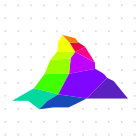
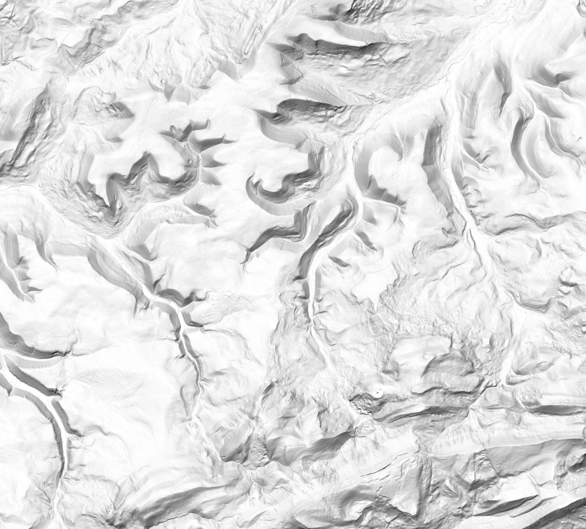

## Mapterhorn Terrain and Imagery

State of the Map Paris, 28.08.2026

Oliver Wipfli

---

## About Me

- Oliver Wipfli
- Based in Zürich, Switzerland
- Consultant in Maps and Location Technology
- Email: oliver.wipfli@leichteralsluft.ch
- GitHub: https://github.com/wipfli
- LinkedIn: oliver-wipfli-562258210

---

## About Mapterhorn

- Aggregation of open terrain data
- Global low-resolution coverage, local high-resolution lidar
- For hillshading, contour lines, routing, u.s.w.
- Soon also aerial imagery tiles

---

## History

           

---

## Outline

- Input
- Aggregation
- Output and Usage
- Sponsors
- Imagery
- Contributing

---