## Mapterhorn Terrain and Imagery

CNG Zürich 2026

Zürich &middot; Oct 29th, 2026

Oliver Wipfli

---

<!-- ## Usage

            -->

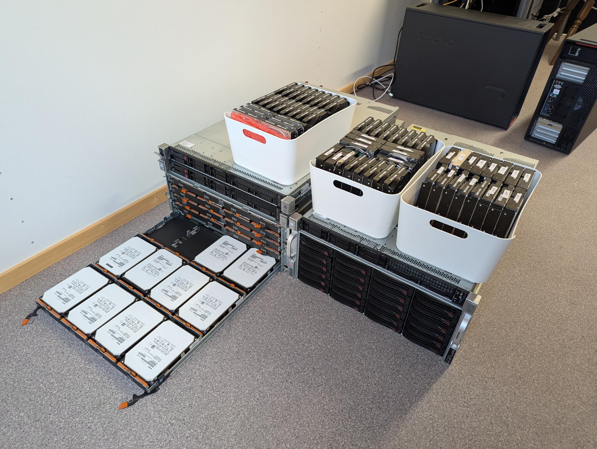

---

## About Me

- Oliver Wipfli
- Based in Zürich, Switzerland
- Consultant in Maps and Location Technology
- Email: oliver.wipfli@leichteralsluft.ch
- GitHub: https://github.com/wipfli
- LinkedIn: <a href="https://www.linkedin.com/in/oliver-wipfli-562258210/">oliver-wipfli-562258210</a>

---

## About Mapterhorn

- Aggregation of open terrain data
- Global low-resolution coverage, local high-resolution lidar
- For hillshading, contour lines, routing, u.s.w.
- Soon also aerial imagery

---

## History

           

<!-- ---

## Outline

- Input
- Aggregation
- Output and Usage
- Funding and Governance
- Contributing
- Outlook -->

---

## Input

- Global: Copernicus 30 m resolution
- Local: High-resolution Lidar
- 70 data producers
- 18 TiB total input data, shared as tarballs
- <a href="https://mapterhorn.com/attribution">mapterhorn.com/attribution</a>
- License CC-BY "or less"

   

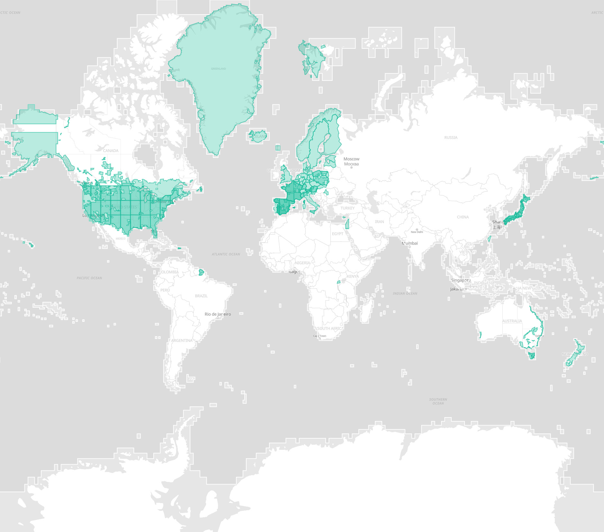

---

## Input Normalization

- Download from geoportal
- Store LICENSE.pdf and metadata
- Set consistent projection and NoData value
- Store as GeoTiffs with unified compression and internal tiling
- Pack GeoTiffs, license, and metadata into a tarball
- Normalized tarballs available for download at <a href="https://mapterhorn.com/attribution">mapterhorn.com/attribution</a>

<!-- ---

## Aggregation

           

---

## Aggregation

           

---

## Aggregation

           

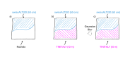

---

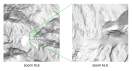

---

## Rounding

- Terrarium: elevation = 256 * red + green + blue / 256 - 2 ** 15
- zoom 19:
  - dx = 0.15
  - dh = 1 / 256
- zoom 18:
  - dx = 0.3
  - dh = 2 / 256
- zoom 17: ...

   

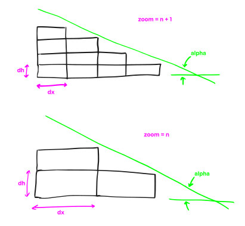

---

## Rounding

           

 -->

---

## Hardware Requirements

### CPU
- Total number of tiles: 155M
- WebP lossless encoding ~200 ms per tile -> 359 days
- With 32 threads -> 11 days for WebP encoding alone, add 50% for reprojection and merging

### RAM
- Only 200 MiB per thread -> 6.25 GiB for 32 threads
- Tune down GDAL_CACHEMAX and GDAL_MAX_DATASET_POOL_SIZE

  

---

## Output

- 11.8 TiB elevation tiles
- 458 PMTiles archives
- planet.pmtiles: global, zoom 0-12
- 6-x-y.pmtiles: local, zoom 13-var
- <a href="https://mapterhorn.com/data-access">mapterhorn.com/data-access</a>

   

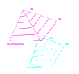

---

## Hosting

           

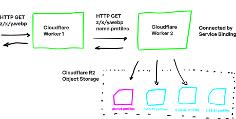

---

## Usage

           

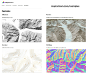

---

## Users

- Media
  - ORF, SVT, zeit.de, FAZ, Seattle Times, The Guardian
- Routing
  - GraphHopper
- Outdoor
  - Komoot, outdooractive

---

## Funding

           

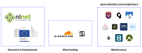

---

## Governance

           

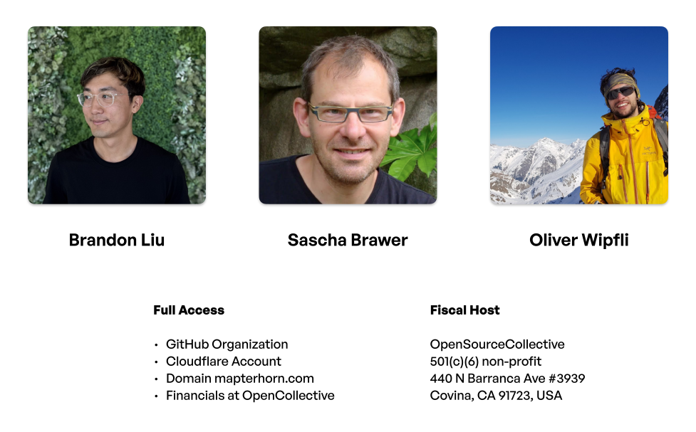

---

## Contributing

- Share bug reports, suggest new or updated datasets
  - https://github.com/mapterhorn/mapterhorn
- Contribute financially
  - https://opencollective.com/mapterhorn

---

## What's Next

- Aerial Imagery
- Same producers, "same" format, same pipeline
- Challenges: 
  - 10x more data (100+ TiB)
  - Updates more frequently
- Maintenance, maintenance, maintenance

   

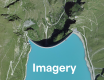

<!-- ---

## Imagery Coverage

- Global: Sentinel-2 imagery 10 m
- High-resolution: 18 countries and regions
- Focus first on Europe, then expand to JP, NZ, US, CA, etc...
- First release still in 2026
   

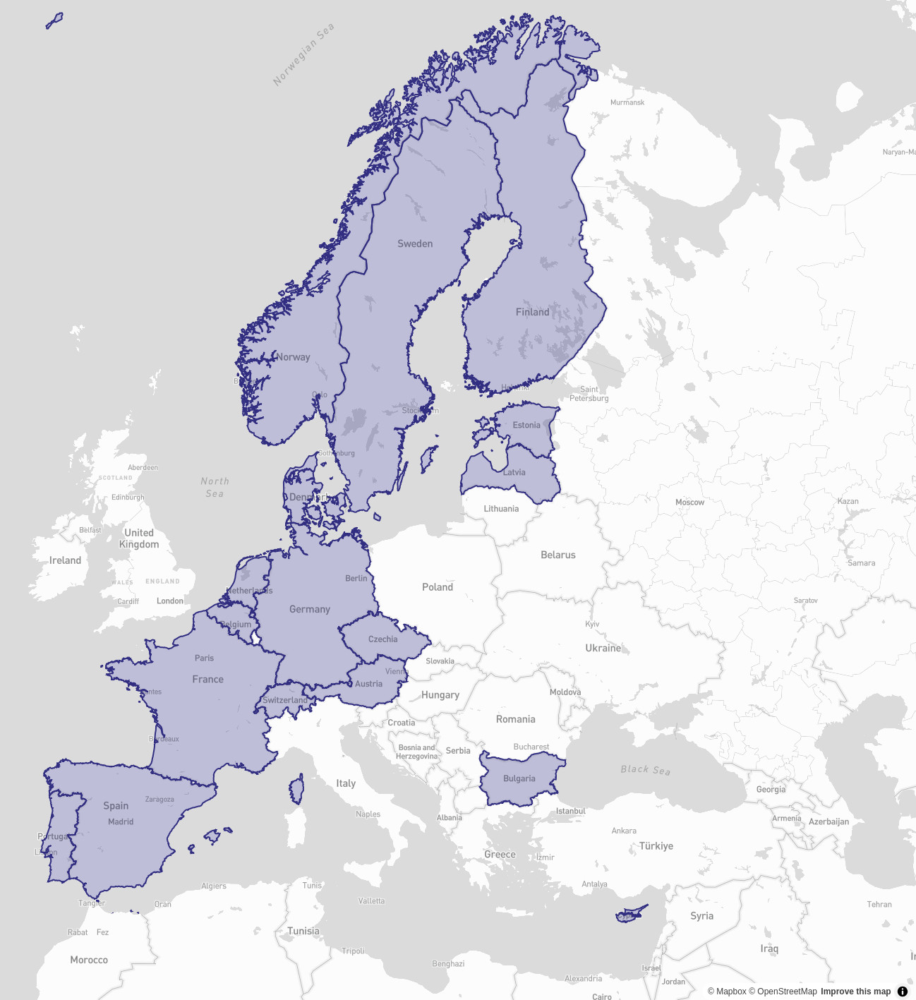 -->

---

## Thank You!

- oliver.wipfli@leichteralsluft.ch
- Get a Mapterhorn sticker or key chain after the talk...
